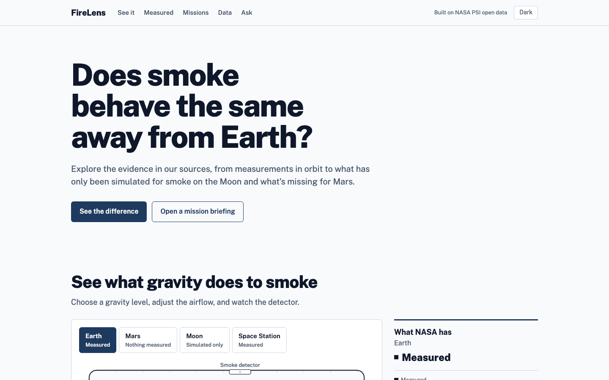
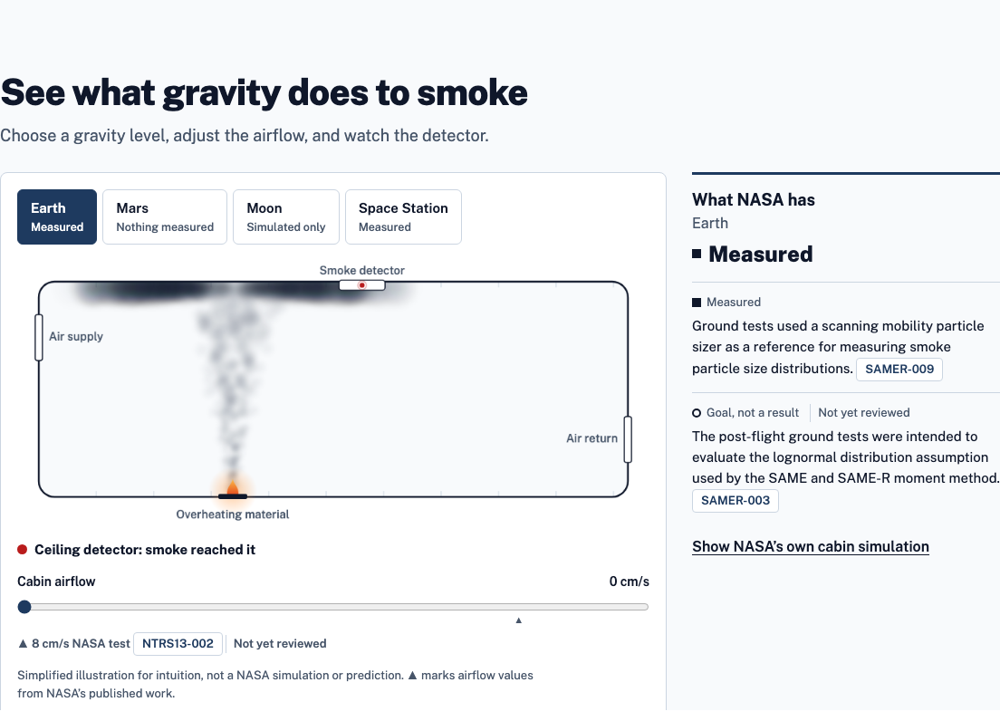
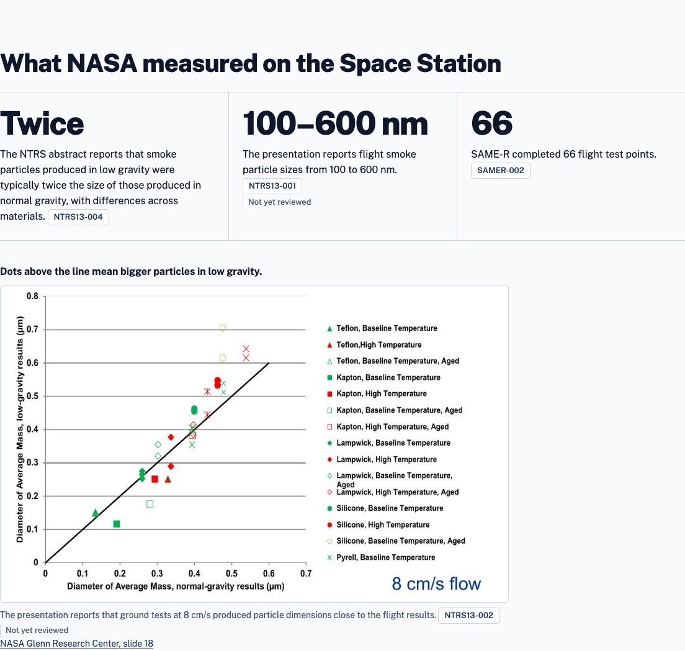
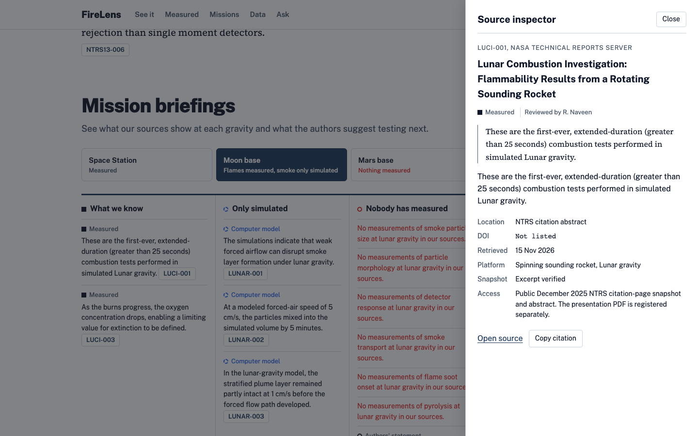
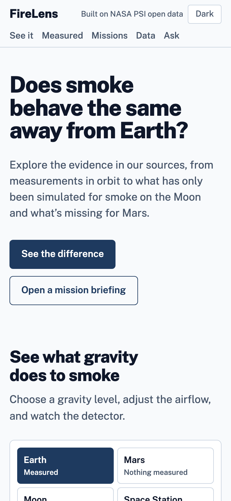

# FireLens

A source-linked explorer for NASA microgravity combustion evidence. Built by team Anantyam for the [2026 NASA Space Apps Challenge](https://www.spaceappschallenge.org/2026/), [Flame in Freefall](https://www.spaceappschallenge.org/2026/challenges/flame-in-freefall/) challenge.

**[Live demo](https://firelens-navy.vercel.app/)**

FireLens shows what the compiled sources measure about smoke and fire away from Earth, what they only simulate, and where they are silent. Every scientific statement on the page is bound to a verified excerpt in the corpus. Search and ranking use deterministic text matching. The running app does not call an AI model.

## Screenshots



The landing page states the question the site is built to answer, then opens into a gravity-aware cabin illustration.





Structured values from the corpus, shown next to the original NASA chart. Each figure and number is linked to a claim.



The Source Inspector shows the stored excerpt, review status, and a link back to the source.



## What it shows

- **See it.** Choose a gravity level, adjust airflow, and watch a simplified cabin illustration. Status labels (Measured, Simulated only, Nothing measured) are computed from claims. The illustration is for intuition only. It is not a NASA simulation or a prediction. Airflow markers come from published values in the corpus.
- **Measured and Detectors.** Headline values and detector specifications taken from structured claim fields, plus two figures cropped from a NASA presentation in the corpus.
- **Explore.** Group investigations by hardware family, read attribute cards built only from verified claims, and compare two or three studies side by side. Similarities and differences come from those structured fields, not from free-form interpretation.
- **Mission briefings.** Separate views for the Space Station, a Moon base, a Mars base, and Earth, with columns for what the sources report, what they only simulate, what they do not measure, and what they suggest testing next.
- **Habitat relevance.** Rank investigations for a spacecraft cabin, a surface habitat, or a pressurized rover from visible, cited factors. A habitat tag appears only when a source names that habitat; otherwise the study is labeled Not assessed. Challenge-stated and planned atmospheres are kept distinct from measurements.
- **Moon and rover bounds.** A bounds panel separates challenge-statement figures from planned test conditions, and bounds what the corpus can support at partial gravity. E-FIELD is not treated as a measured habitat result. No measured Moon or rover cabin atmosphere is in this corpus.
- **Insights.** Briefings on prevention, detection, suppression, and Earth applications, composed only from verified claims. Challenge-statement items such as water-mist extinguishers and firefighter gear are labeled as context, not as NASA measurements.
- **Data.** A table of extracted values, conditions, materials, gravity, airflow, and sources, including flammability claims even when no numeric value has been extracted, with CSV and JSON export.
- **Ask.** Search the corpus, read an evidence answer, and open a deterministic interpretation assembled from cited claims with fixed templates. The running app does not call an AI model. Queries can be shared with `?q=` links. Draft claims are labeled "Not yet reviewed."

## How evidence is verified

Claims live in [`corpus/claims.json`](corpus/claims.json). Each claim stores a verbatim excerpt, a source location, a classification (measured result, method, computer model, or objective), and a review status. In the current corpus, 35 of 152 claims have been human-reviewed. The rest remain drafts and are labeled as such wherever they appear.

[`corpus/manifest.json`](corpus/manifest.json) records the source URL, retrieval date, and SHA-256 hash of every snapshot. `npm test` runs the corpus verifier before the unit tests. The verifier checks snapshot hashes, reproduces the stored text from those snapshots, matches excerpts and numeric tokens, and validates claim references and classifications. It runs offline.

Clicking a claim code opens the Source Inspector, which shows the stored quote, review status, and a link to the original source.

Claims may be drafted with AI assistance. The verifier then checks each excerpt against the stored source, and a person reviews a subset. Once the app is running, answers and interpretations are assembled only from those checked claims, using deterministic ranking and fixed templates rather than a live model. Challenge context and planned test conditions are labeled so they are not presented as NASA measurements.

Some snapshots are designated local-only and are not in the public repository, including third-party copyrighted texts. The verifier reports missing local-only files as skipped, and the app omits claims whose snapshots are unavailable. To reproduce the full evidence shown in production, restore those files at the `raw_file` paths listed in the manifest, then run `npm run extract-text` and `npm test`.

## Sources

The [source register](docs/sources.md) is generated from the manifest. The corpus is built primarily from NASA [Physical Sciences Informatics (PSI)](https://psi.nasa.gov/physci/repo/search?q=combustion) investigation records and documents from the [NASA Technical Reports Server](https://ntrs.nasa.gov/), with additional public or locally held literature where a claim required it. The current manifest lists 43 source snapshots. The PSI combustion search used for the investigation index returned 24 investigations. Eighteen of those currently have extracted claims. The others are indexed as metadata only.

Three papers could not be retrieved in full and are represented by abstracts. The attempts are recorded in [`corpus/unavailable.json`](corpus/unavailable.json).

Corpus excerpts are quoted from the cited sources. Full texts designated as local-only are not included in this repository. Source materials retain their own licenses and copyright notices.

Regenerate the register with `npm run docs:sources`.

## Tech stack

- Next.js 16 (static export) and React 19
- TypeScript
- Tailwind CSS 4
- Vitest for unit tests
- Playwright for end-to-end tests

The production site is a static export, hosted on Vercel. Node.js 20.19 or newer is required.

## Getting started

```sh
npm ci
npm run dev
```

Open http://localhost:3000. In the Ask section, press `/` to focus search, use the arrow keys to move through ranked investigations, and press Enter to open a source. Escape closes the Source Inspector.

`npm run build` verifies the corpus, type-checks the project, and writes a static export to `out/`.

Useful corpus commands:

- `npm run fetch-sources` verifies local raw files and tries to restore missing bytes from their manifest URLs. If an upstream file has changed, the command reports the mismatch and keeps the recorded version.
- `npm run extract-text` regenerates extracted text, including one-based PDF page markers.
- `npm run docs:sources` regenerates `docs/sources.md`.
- `npm run docs:claims` regenerates a local draft claim review in `docs/claims-review.md`. That file is gitignored.

## Testing

```sh
npm run lint
npm test
npx playwright install chromium   # once
npm run e2e
npm run check:links
```

`npm test` runs the corpus verifier, then Vitest. Playwright serves the static export locally unless `FIRELENS_TEST_URL` points at a deployed site. The end-to-end suite covers the main demo path at 1440 and 375 widths, including keyboard use and accessibility checks. `npm run check:links` performs the network source checks.

## Project structure

```
app/              Next.js app shell and styles
components/       Landing sections, Ask, and the Source Inspector
lib/              Search, ranking, and claim helpers
corpus/           claims.json, manifest, snapshots, and the investigation index
docs/             Source register, process notes, and README images
docs/images/      Screenshots used in this README
e2e/              Playwright tests
scripts/          Corpus fetch, extract, verify, and documentation generators
public/figures/   Cropped NASA figures shown in the app
```

## License

The FireLens software is released under the [MIT License](LICENSE), copyright Team Anantyam.

## Acknowledgements

FireLens depends on open investigation records from NASA Physical Sciences Informatics and on documents from the NASA Technical Reports Server, along with the other works listed in the [source register](docs/sources.md). Those materials remain under their original licenses. This project is not affiliated with NASA beyond participation in the Space Apps Challenge.
